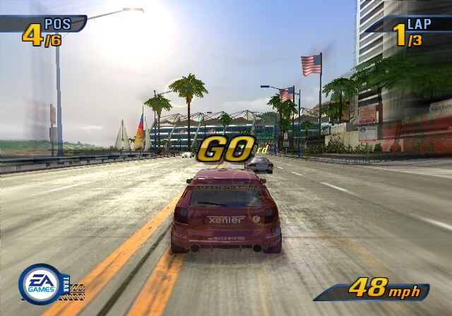
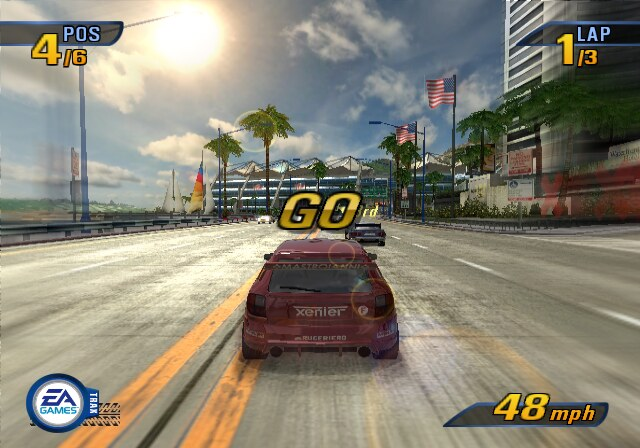
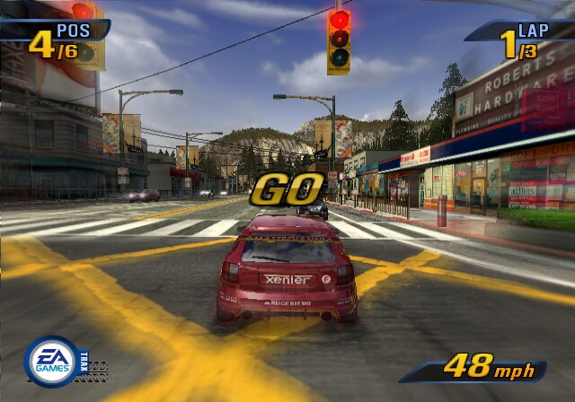
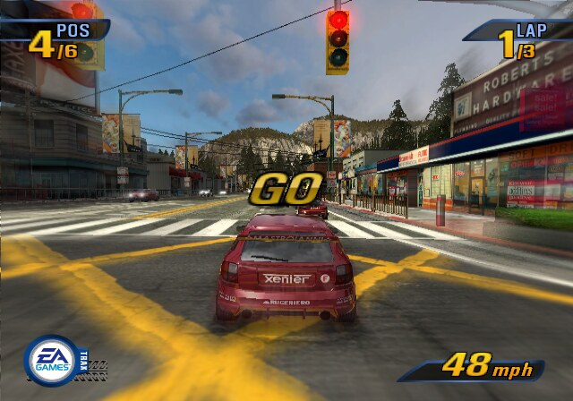
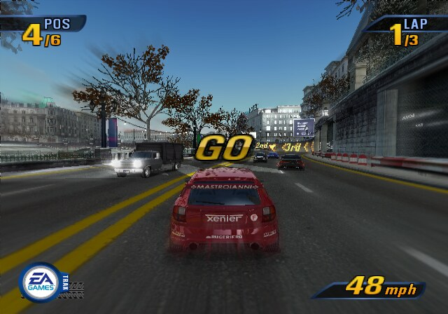
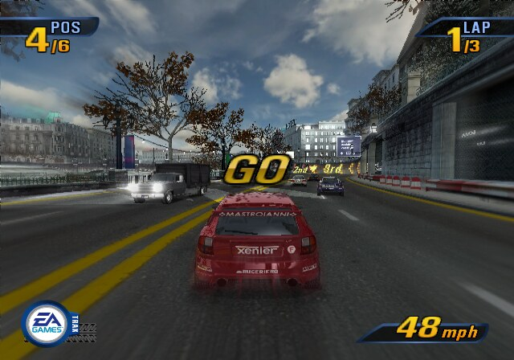

# Takedawn Mods

A collection of mods for [Takedawn](https://github.com/xenophobentx/takedawn), the native recompilation of Burnout 3: Takedown. Each mod has its own folder, version, credits and installation notes.

## Mods

| Mod | Version | What it changes |
| --- | --- | --- |
| [Sky Variety](mods/sky-variety/) | 1.2.1 | Eleven sky images across 37 track variants, with new cloud masks and matching sky gradients. |

Download installable ZIPs from [Releases](https://github.com/rigerc/takedawn-mods/releases). Each release is named for its mod, so mods can be updated independently.

## Previews

Sky Variety in game, stock on the left and the mod on the right. More tracks are in the [mod's README](mods/sky-variety/README.md#in-game-comparison).

| Track | Stock | Sky Variety 1.2.1 |
| --- | --- | --- |
| US/C1_V1<br>Sunflowers daylight |  |  |
| US/C3_V1<br>Industrial Sunset |  |  |
| EU/C1_V2<br>Sunflowers daylight |  |  |

## Install a mod

1. Download the ZIP for the mod you want and extract it into Takedawn's mods folder. Copy the individual mod folder, such as `sky-variety/`, rather than this whole repository.
2. Open Takedawn's **Settings → Mods** and enable the mod.
3. Restart the game to apply it. Disable the mod and restart to restore the original files.

| Platform | Default mods folder |
| --- | --- |
| Linux / Steam Deck | `~/.local/share/takedawn/mods/` |
| Windows | `%APPDATA%\Takedawn\mods\` |
| macOS | `~/Library/Application Support/Takedawn/mods/` |
| Portable mode | `data/mods/` next to the executable |
| Android | `mods/` inside the app's files folder |

For example:

```text
mods/
└── sky-variety/
    ├── mod.toml
    └── textures/
        ├── pack.toml
        └── <texture-hash>.png
```

You can also copy a mod directly from this repository's `mods/` directory. Takedawn must support the file or texture replacement format the mod uses. See the upstream [mod folder documentation](https://github.com/xenophobentx/takedawn/blob/main/docs/mod-folders.md) and each mod's README for requirements and conflicts.

## Repository layout

```text
mods/                   Installable mods, one folder per mod
  sky-variety/          Sky Variety's files, credits and validation notes
tools/                  Build tools and source-asset metadata
requirements-build.txt  Optional dependencies for rebuilding artwork
```

Players do not need Python or the build tools to install a mod.

## Add another mod

Create `mods/<mod-name>/` with a unique `mod.toml` ID, a README, the installable replacement files and the relevant licence and credits. Document conflicts, supported game data, checks performed and known limitations. Add the mod to the catalogue above.

Use a tag such as `<mod-name>-v<version>` for a release. Its ZIP should contain just that mod's folder, ready to extract into the game's mods directory. Keep source downloads, build output and local test captures out of Git.

Contributions must be redistributable: include original work or assets whose licence permits redistribution. Do not commit retail game files, extracted original textures, executables, saves or texture-dump comparison pages. The game and its disc data are not included here.

## Licences and support

Repository build tools and documentation are [MIT licensed](LICENSE). Mod artwork has its own licence; Sky Variety's source artwork is CC0, with authors and source links in its [credits](mods/sky-variety/CREDITS.txt) and [asset licence](mods/sky-variety/LICENSE.txt).

Report mod problems in [Issues](https://github.com/rigerc/takedawn-mods/issues), including the mod version, Takedawn version, platform, track and other enabled mods. This is an unofficial collection; game runtime issues belong in the upstream project after checking whether they also occur with mods disabled.
